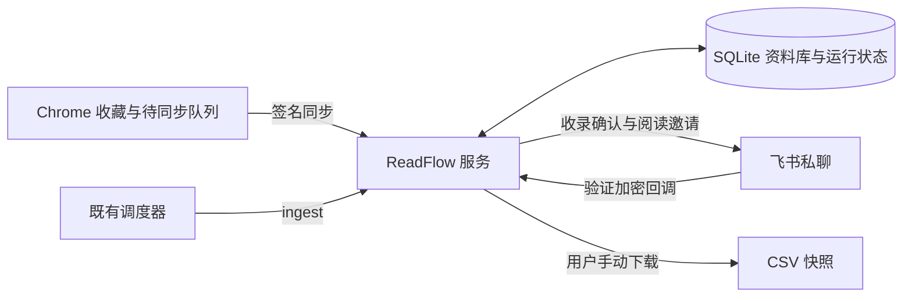

# 架构

**服务端 SQLite 是唯一主库。**

Chrome 先保存标题、链接、标签和笔记，再尝试同步。首次可明确选择本机模式；服务临时离线时保留待同步队列。本机缓存不是第二主库或完整备份。已关联记录的状态修改须得到服务确认。

`examples/database.js` 管理记录、编辑与卡片操作 ID、运行状态。URL 唯一约束防止重复收藏，事务保证批次原子性，编辑 UUID 防止旧请求覆盖新修改。资料库身份不依赖飞书账号或导出表。

`connector/database-runtime.js` 提供数据库操作与调度入口。`examples/host.js` 组装数据库、跨进程锁、配对和可选飞书能力。`examples/feishu-service.js` 负责当前服务的飞书发消息。收藏、健康检查、状态和 CSV 不调用飞书。

`examples/feishu-inbox.js` 校验加密、签名、Token、应用及会话／用户白名单。事件持久化入队后确认接收，由任务实际落库并发送收录结果。卡片操作还需匹配已发送消息、请求和记录绑定。

既有调度器运行 `ingest` 处理链接队列；每日提醒暂时移除。发送 UUID 在发送前持久化，不确定结果仅在去重窗口内重试，超时需人工核对。送达不代表已读。

CSV 是用户主动下载的资料快照，先同步待发送收藏，失败则停止导出。不保留多维表格同步。对话入口由用户现有 agent 提供，不限定平台；飞书仅提供当前可选收录／提醒，后续分析交给现有 agent；ReadFlow 不调用模型 API。独立 agent 配对授权查询及确认后的回顾追加；复用 HTTPS 与 SQLite，不共享 Chrome 密钥，见 [agent 接入](AGENT.md)。

## 代码边界

- `src/`：Chrome 页面、后台与浏览器所需共享校验。安装包仅包含此目录、清单、图标和许可证。
- `connector/`：连接协议、运行时；`connector/lib/` 存放服务端字段、消息、导出工具，不进入 Chrome 安装包。
- `examples/`：可运行的 SQLite 参考服务、飞书集成与操作入口。
- `scripts/`：打包、环境检查、安全检查和可选建表。
- `test/`：本地及模拟接口测试。底层表格适配器仍有参考与测试用途，不作为当前服务主库。

参考实现面向单机 POSIX，无 npm 运行依赖。备份需停服务并复制完整私有状态目录。尚未实现多机集群、统一删除、正文抓取、视频转写、Chrome 回顾展示和定时 AI 回顾。

[配置](../SETUP.md) · [接口](CONNECTION.md) · [安全](../SECURITY.md)

`examples/agent-api.js` 提供有限查询与引用校验后的追加；`examples/agent-client.mjs` 为已有 agent 提供签名工具。SQLite 的 reviews 表保存确认内容和引用快照，reading_events 保存服务端状态变更；修改素材不会改写已存回顾。
